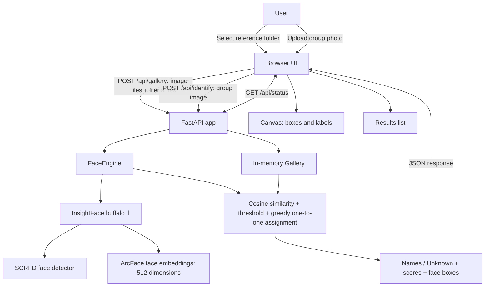

# Architecture — Who Is in the Photo?

## Scope

This document describes the implementation currently present in this repository. The application is a local web app for Task A: a user selects a folder of named reference photos, uploads one group photo, and sees detected faces labelled with a matching name or `Unknown`.

**Important status:** the diagram below is a source-level architecture diagram in Mermaid. The assignment brief specifically asks for an Archify-generated diagram/export or screenshot. That Archify artifact has not yet been generated or checked into this repository; do not describe this Mermaid diagram as an Archify export.

## System diagram

## Runtime flow

### 1. Reference gallery

1. The user selects a folder through the browser's directory picker.
2. The browser sends the image files to `POST /api/gallery`; filenames are used to derive person names. Trailing numbering supports multiple reference images for one person (for example, `person1.jpg`, `person2.jpg`, subject to the filename parser).
3. The API passes the files to `FaceEngine.build_gallery()`.
4. Supported images are decoded with OpenCV. InsightFace's `buffalo_l` model detects faces and produces normalized ArcFace embeddings.
5. Successful entries and warnings are held in an in-memory `Gallery`. The gallery is not persisted and is lost when the server restarts.

**Current reference-image limitation:** the implementation currently chooses the largest detected face when a reference image contains multiple faces and adds a warning. It does not yet reject every multi-face reference image. A zero-face or unreadable image is skipped with a warning.

### 2. Group-photo identification

1. The browser sends the group photo to `POST /api/identify`.
2. The engine detects faces and computes one embedding per detected face.
3. The matcher calculates cosine similarity between each group-photo embedding and all gallery embeddings.
4. If a person has several reference photos, the highest similarity among that person's photos is used.
5. Candidate face/person pairs at or above the configured threshold (default `0.40`) are sorted by score. A greedy one-to-one assignment ensures a person is assigned to no more than one face in the group photo.
6. Unassigned faces are labelled `Unknown`. Results include face boxes and similarity scores, and are returned to the browser.
7. The browser draws boxes and labels on a canvas and displays a corresponding results list.

The threshold is an initial setting, not an evaluated accuracy boundary. The greedy assignment is simple and explainable, but it is not guaranteed to find the globally optimal assignment.

## Main components

| Component | Responsibility |
|---|---|
| `app/main.py` | FastAPI routes, request handling, gallery state, static page serving |
| `app/face_engine.py` | Image decoding, face detection, gallery construction, embeddings and matching |
| InsightFace `buffalo_l` | Local face detector and face-recognition model |
| SCRFD | Face detection stage in the selected model pack |
| ArcFace | Face representation / recognition embedding stage |
| `app/static/index.html` | Browser UI structure |
| `app/static/style.css` | UI styling |
| `app/static/app.js` | Folder/photo upload, API calls, canvas annotations and result list |
| `tests/` | Unit and API tests; current automated suite has 25 passing tests |

## API surface currently documented in the development log

- `POST /api/gallery` — build/replace the in-memory reference gallery.
- `POST /api/identify` — identify faces in an uploaded group photo.
- `GET /api/status` — report application/gallery status.
- `GET /` and static asset routes — serve the browser UI.

## Trade-offs

- **Local FastAPI + browser UI:** avoids a separate frontend build tool and gives non-technical users a visual workflow. It still requires starting a local server.
- **InsightFace `buffalo_l`:** provides a pre-trained detector and recognizer in one model pack. The model must be downloaded before use and its pretrained weights are restricted to non-commercial research use under the model terms.
- **SCRFD + ArcFace embeddings:** separates face localization from identity representation. The implementation uses the model pack's detector and recognition modules only.
- **Cosine similarity with a threshold:** easy to explain and computationally straightforward. A threshold that has not been calibrated can cause false matches or false unknowns.
- **Best-reference-photo score:** allows multiple reference photos to cover different poses/lighting. It can also make a person score highly based on one accidental similarity.
- **Greedy one-to-one assignment:** prevents assigning the same identity to multiple faces in one image and is easy to audit. It is not globally optimal like a bipartite matching algorithm.
- **In-memory gallery:** simple for a single-user local demo and avoids storing biometric data between runs. The user must reload the gallery after restarting the app.
- **CPU execution:** avoids requiring a dedicated GPU and improves portability, at the cost of slower inference than a suitable accelerator.
- **No cloud inference in the app:** aligns with the assignment's offline runtime rule. Offline operation has not yet been verified with Wi-Fi disabled, so it is not claimed as tested.

## Security and privacy considerations

Face embeddings are sensitive biometric data. The current design keeps the gallery in server memory and does not intentionally persist uploaded images or embeddings. The app is intended for local, single-user use and binds to `127.0.0.1` in the documented run command. Do not expose it to a public network. The Git repository intentionally excludes personal reference photos, model weights, embeddings, virtual environments and secrets.

## Verification status

- Automated tests: 25 passed in the reported clean-checkout run.
- Real-model smoke test: InsightFace's bundled sample group image produced 6 detections; two cropped references matched at approximately 0.98 and 0.99, and four other faces were Unknown. These crops came from the same source image, so this is a pipeline smoke test, not an accuracy evaluation.
- Browser end-to-end test: pending.
- Wi-Fi-disabled offline test: pending.
- Archify diagram export/screenshot: pending.
- Evaluation on held-out, labelled real group photos: pending.
